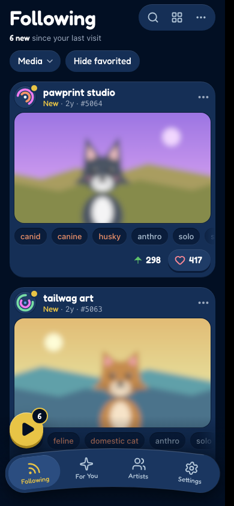
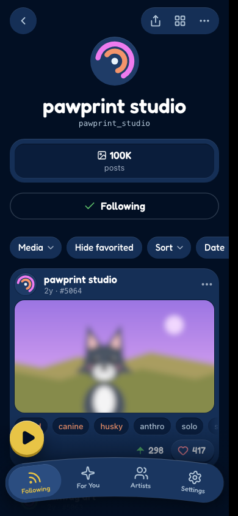
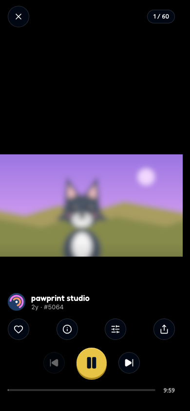
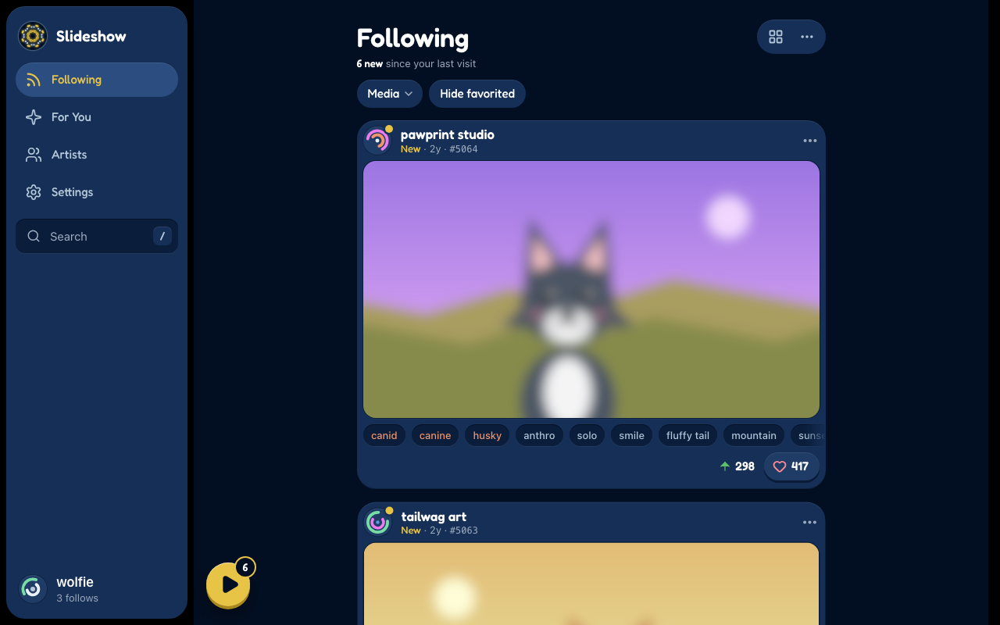
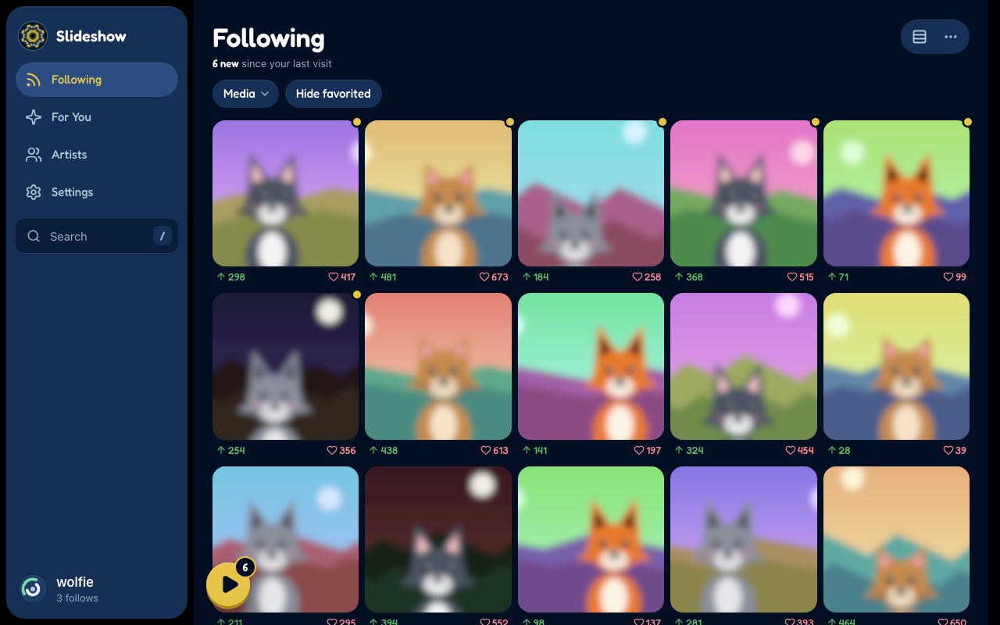
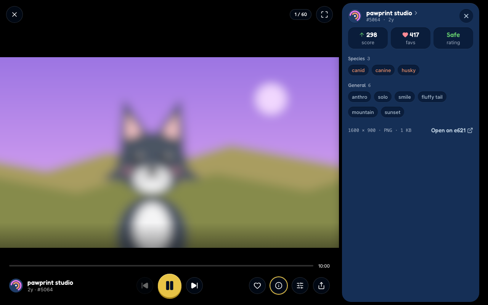
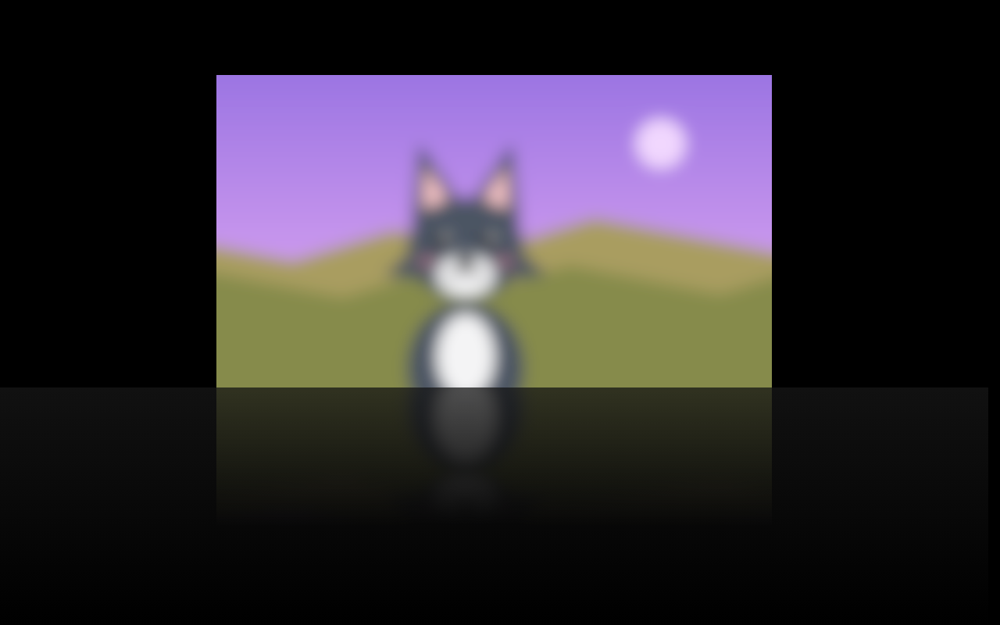
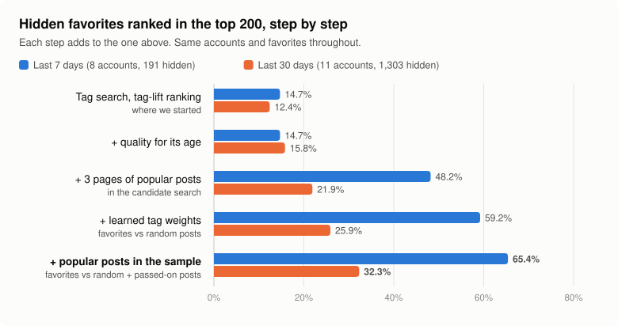
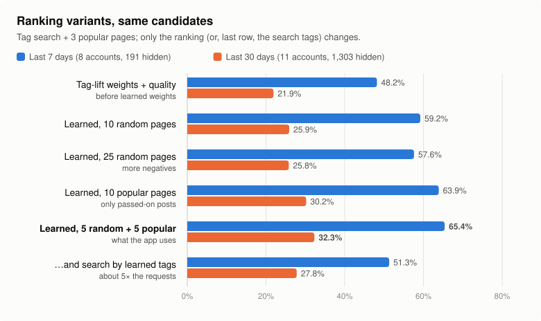

# eLicks21

A browser for e621 (unofficial). Say it like "e621": Licks rhymes with six.

A scroll-first e621 client: a feed of the artists you follow, a **For You** feed that learns your taste
from your favorites, artist pages, and a full-screen slideshow with five styles. It works on a phone
(installable as an app) and on a computer. Not made by or affiliated with e621.

Live at **<https://e621.cumdump.dog>**. Everything runs in your browser and talks to `e621.net` directly
(the API allows CORS), so your API key never touches a server.

| Following on a phone | An artist | The slideshow |
|---|---|---|
|  |  |  |



> Screenshots use generated, blurred placeholder characters against a mocked e621, never real posts.
> See [Regenerating the screenshots](#regenerating-the-screenshots).

## Quick start

```bash
pnpm install
pnpm dev            # http://localhost:3000
```

1. Open **Settings › Account** and sign in with your e621 username and
   [API key](https://e621.net/users/home) (tick **Remember** to keep it on this device).
2. **Following** shows new posts from the artists you follow on e621. Follow more from any card,
   artist page, or **Artists › Suggested**.
3. Press **Play** (the round gold button) to watch any feed as a slideshow.

Signed out, **For You** shows what's popular and Search works as usual.

## Contents

- [Features](#features)
- [Keyboard shortcuts](#keyboard-shortcuts)
- [Share links and launch links](#share-links-and-launch-links)
- [Userscript](#userscript)
- [How it works](#how-it-works)
- [Recommendation research](#recommendation-research)
- [Development](#development)

## Features

### The tabs

- **Following**: posts from the tags you follow on e621 (its `search:subscriptions`), newest first.
  New posts since your last visit are marked, with a "caught up" divider where the new ones end.
  e621's own visit marker keeps this in step with the site. Pull down to refresh.
- **For You**: posts ranked by how well they match your favorites (see [Recommended](#recommended)).
  **Tune** pins or mutes tags.
- **Artists**: who you follow, with a dot for new posts, filter and sort; **Suggested** lists artists you
  favorite a lot but don't follow yet, and **Follow from favorites** follows several at once.
- **Settings**: Account, Content (ratings and blacklist), Slideshow, For You, and App (install, data,
  about). On a computer it is one page.

### Feeds



- Every feed is a column of cards or a **grid** (the grid button). Each card shows the artist, the
  picture, its tags and score, a heart, and **Follow** for artists you don't follow.
- **Chips** filter a feed: media, hide favorited, sort, upload date, minimum score. They live in the URL,
  so Back and a copied link agree.
- **Hold a tag** for half a second and targets pop up over it: drag onto **Search** to add it to the
  search, onto **Blacklist** to hide it (with Undo), or onto **Open** for an artist's page.
- **Hold a grid tile** (or right-click it on a computer) for Favorite, Open artist, Play from here and
  Open on e621.
- **Search** with e621 autocomplete; any e621 syntax works. Searches can be saved with the star.
- Your place in each feed is kept across Back, tab switches and reloads.

### Artist pages

A big mark, the name, stats (posts, how many you faved, the last post), one wide **Follow** (with Undo),
then the artist's posts with the same chips. **Share** copies a link to the page.

### The slideshow



**Play** on any feed, or **Play from here** on a card, starts the show at that post. Controls: previous,
pause, next, a progress bar with time left, favorite, Post info (stats and tags, each tag with the same
targets), Quick settings (style, seconds, fit, mute, quality) and Share. Closing it returns to the post
you were on.

### Slideshow styles

Pick one in **Settings › Slideshow**, or for this show only from the player's sliders button.

| Vintage Prints | Ken Burns |
|---|---|
|  |  |
| The current post as a colour print on a heap of grey prints, drifting slowly. | Full-bleed slow pan and zoom. Videos stay still. |
| **Collage** | **Reflections** |
|  |  |
| The last three posts as tiles, re-flowing into whichever layout shows the most image. | The post on a black floor with its mirror image; slides enter from the right. |

**Classic** (the default) is a plain full-screen slide with **Fit** (fit / fill / 1:1) and **Transition**
(fade / none) options.

Other playback settings:

| Setting | Default | What it does |
|---|---|---|
| Seconds per slide | 6 | 1 to 300 |
| Preload next | 4 | How many upcoming posts to fetch ahead |
| Quality | Original | **Fast** uses e621's smaller samples |
| Max video length | 60 s | Cut long videos short; `0` plays them to the end |
| Mute videos | on | |
| Start over after the last post | on | Loop the search |

### Recommended

**For You** (needs sign-in) is the Recommended feed. The app reads your favorites, finds the tags you
favorite far more often than e621 does overall, and ranks recent posts by how well they match and how
well liked they are for their age. Posts you've already favorited are left out.

- The match comes from a small model fit in your browser: your favorites against a sample of e621
  (5 pages of random posts and 5 of popular ones from the last few months, minus your favorites). It
  learns which tags you seek out and which you pass on. Each favorite's tags are kept in this browser,
  and the sample is retaken once a month.
- Candidates come from two searches in the window: your top tags, plus its most popular posts (3 pages),
  so a well-liked post with only some of your tags still gets ranked. When your top tags run out of posts,
  the search goes on with the next ones by weight, up to 3 rounds, within the same 25 pages.
- **Tune** (the sliders on For You) holds the rest. **Breadth** sets how many of your top tags are searched together.
  At most a third of them are names (artists and characters together) while other tags are left, since names
  are rare on e621 and would otherwise take every slot for someone with many favorites. Characters also weigh
  half as much as other tags. **Filter artists** leaves artist tags out of
  your taste altogether. e621's do-not-post marks (`avoid_posting`, `conditional_dnp`, …) never count.
- **Pin** a profile tag to always search it. **Mute** a tag to hide posts carrying it.
- The window defaults to the last 7 days; change it with the date chip.
- Only new favorites are read on each visit. Nothing re-ranks on its own: **Update ranking** appears when
  there is something new to rank, and **⋯ › Refresh** ranks again.
- Nothing shows until every candidate page is ranked, so the best post comes first.

Every part of this was tested against real favorites first: see
[Recommendation research](#recommendation-research).

### e621 account

- Sign in with your username and API key. **Remember** keeps the key on this device; without it,
  nothing about your account stays after the tab closes.
- Signing out removes everything kept for the account: follows, the Following marker's copy, the
  favorites profile, feed places and the goo.
- Your e621 blacklist syncs on sign-in; edit the local list in **Settings › Content**.
- **Sign-in links** (off by default) put your key in a share link's `#` fragment so a friend's tab is
  signed in as you for that tab only. Only share those with people you trust with your key.

### Install

On a phone, **Settings › App › Install** walks through adding it to the home screen. It works offline
for what it has already loaded, and offers **Reload** when a new version is out.

### On a computer

From 900 px wide: a sidebar with the tabs, Search (**/**) and your account; feeds in a 600 px column;
grids at full width; sheets as dialogs; Post info as a panel beside the picture.

## Keyboard shortcuts

| Key | Where | Action |
|---|---|---|
| / | Anywhere on a computer | Search |
| Esc | Anywhere | Back (closes a sheet, the player, or a pushed screen) |
| ← → | Player | Previous / next |
| Space | Player | Pause / play |
| F | Player | Fullscreen |
| I | Player | Post info |
| L | Player | Favorite (signed in) |
| C | Player | Copy share link |
| O | Player | Open the post on e621 |
| S | Player | Quick settings |
| G / T | Player | Close the player (back to the feed) |

The previous one-page app is still there for now: **Settings › App › Classic slideshow** (its gallery,
scroll view and settings drawer, with their own keys).

## Share links and launch links

There are two kinds of link.

**Share links** (**C** or the link button) carry the search *and* how it plays. They start the show
straight away and save nothing until the visitor changes a setting. Only values that differ from the
defaults are included:

| Param | Meaning | Example |
|---|---|---|
| `v` | Link format version | `1` |
| `tags` | Search tags | `fox+solo` |
| `r` | Ratings | `sq` (safe + questionable) |
| `m` | Media: **i**mage, **g**if, **v**ideo | `ig` |
| `order`, `seed` | Order, and the shuffle seed for `random` | `random`, `48213` |
| `min` | Min score | `50` |
| `d`, `dp`, `d1`, `d2`, `dn`, `du` | Upload-date filter | `d=preset&dp=week` |
| `style`, `int`, `fit`, `tr`, `q` | Style, seconds, fit, transition, quality | `style=kenburns&int=10` |
| `mute`, `vmax`, `loop` | Video mute, max length, loop | `mute=0` |

The blacklist and everything Recommended-specific are never shared.

**Include my sign-in in share links** (e621 account section) adds your username and API key to the
link's `#` fragment. Browsers never send the fragment to a server; the visitor is signed in for that tab
only and nothing is saved. Only share these with people you trust with your key.

**Launch links** (`/?tags=wolf+solo`) play an e621 search straight away, exactly as e621 runs it:
default filters (all ratings and media, newest first), so you see the same posts. Your own blacklist
and playback settings (style, speed…) still apply, and nothing is saved. The [userscript](#userscript)
uses these.

## Userscript

Adds an **▶ eLicks21** button under the search box on e621.net and e926.net. It plays what's in
the search box (or the pool you're on): the same posts e621 shows, in your saved slideshow style
and speed.

### Install

1. Add a userscript manager to your browser:
   - Chrome, Edge, Brave, Firefox: [Violentmonkey](https://violentmonkey.github.io/) or
     [Tampermonkey](https://www.tampermonkey.net/)
   - Safari (Mac, iPhone, iPad): the free **Userscripts** app from the App Store, then turn it on in
     Safari → Settings → Extensions
2. **Chrome, Edge, Brave only:** let the manager run scripts. Open `chrome://extensions`, click
   **Details** on Violentmonkey/Tampermonkey, and turn on **Allow User Scripts**. (Older versions
   have no such toggle: turn on **Developer mode** at the top right of the Extensions page instead.)
   Without this the script installs but never runs.
3. Open <https://e621.cumdump.dog/e621-slideshow.user.js>. The manager shows an install page.
4. Click **Install**, then reload any e621 page.

The manager checks that same URL for updates. The same steps, with an **Install userscript** button,
are in the slideshow's own settings under **e621 button**.

**No button?** Click the manager's toolbar icon on an e621 page. The script should be listed and
switched on. If the list is empty, recheck step 2 and that the manager is allowed on e621.net.

### Developing it

Source: [`public/e621-slideshow.user.js`](public/e621-slideshow.user.js), served from the site root.
Bump `@version` whenever you change it, or installed copies won't update. The button opens
[launch links](#share-links-and-launch-links) (`/?tags=…`).

## How it works

- **Stack**: Next.js 16 (App Router), React 19, Tailwind CSS 4, deployed on Vercel. There is no backend:
  every route renders the same client shell.
- **Navigation** ([`src/nav/`](src/nav)): the app keeps its own stack of screens in the browser's
  history (tabs, pushed screens, sheets, the player as `?play=`), so Back, the edge swipe and reloads
  all agree, and switching tabs never asks the server for anything.
- **Stores** ([`src/state/`](src/state)): small subscribable stores for the session, follows, Following,
  favorites, For You, preferences and feeds. Requests go through one lane with priorities, a shared
  back-off when e621 says slow down, and timeouts.
- **Installed app** ([`public/sw.js`](public/sw.js)): a service worker caches the app's own files only,
  never e621's API or your key.
- **Query** ([`src/lib/query/build.ts`](src/lib/query/build.ts)): your tags, then rating / type / date /
  score / order metatags, up to e621's 40-tag limit. The blacklist never goes into the query.
- **Blacklist** ([`src/lib/query/blacklist.ts`](src/lib/query/blacklist.ts)): e621's rule semantics,
  run on each post client-side.
- **Queue** ([`src/lib/slideshow/queue.ts`](src/lib/slideshow/queue.ts)): pages through results with
  e621's cursor paging and preloads the next posts.
- **Recommended** ([`src/lib/recommend/`](src/lib/recommend)):
  - `sync.ts` reads favorites incrementally and looks up each tag's site-wide count.
  - `weights.ts` scores each tag by how much more common it is in your favorites than on e621
    (capped, damped for small counts, for a small share of your favorites and for tags common
    across e621, meta tags ignored).
  - `rank.ts` scores a post by its 5 strongest matching tags, so common tags can't swamp a rare favorite,
    then orders posts by taste percentile + quality percentile (favorites compared with posts uploaded
    around the same time).
  - `learn.ts` and `model.ts` fit logistic-regression tag weights (favorites against random and popular
    posts) at sync; when present they replace the match score in the ranking. The lift weights still pick the
    search tags, decide which posts match, and explain them.
  - `stream.ts` fetches the tag search and 3 pages of the window's popular posts, drops your favorites,
    then plays the rest best first.
  - [`scripts/rec-backtest.ts`](scripts/rec-backtest.ts) tests search and ranking changes on live data: it
    hides accounts' recent favorites and counts how many the recommendations would show.
- **Storage** ([`src/lib/storage.ts`](src/lib/storage.ts)): settings, saved searches and history live in
  `localStorage`. Account data (the key, follows, the favorites profile, feed places) is kept on the
  device only with **Remember**, and only for the tab otherwise; sign-out removes it. Each favorite's
  tags, the sample and the learned weights are bigger, so they go to IndexedDB
  ([`src/lib/bigStorage.ts`](src/lib/bigStorage.ts)).

### Project layout

| Path | What's there |
|---|---|
| `src/shell/` | The app shell: tabs, the sidebar on a computer, sheets, lazy screens, the service worker hookup |
| `src/nav/` | Routes and the history-driven screen stack |
| `src/screens/` | Following, For You, Artists, the artist page, Search and Results, Settings, sign-in |
| `src/feed/` | Feed and grid, post cards, chips and their menus, pull to refresh |
| `src/player/` | The slideshow player and its sheets |
| `src/state/` | Stores (session, follows, Following, favorites, For You, prefs, goo) |
| `src/components/` | Shared parts (v6 parts, Goo, states, tag targets) and the classic app (`App.tsx`, `stages/`) |
| `src/lib/e621/` | API client and response types |
| `src/lib/query/`, `src/lib/recommend/`, `src/lib/slideshow/` | Query building, recommendations, queue and layouts |
| `src/lib/share.ts` | Share-link and launch-link encoding |
| `docs/path-a/` | The rebuild's goal, UX, design, engineering notes, decisions, reviews and testing log |
| `e2e/` | Playwright tests against a mocked e621 |
| `scripts/` | Live smoke test, test-video generator, README screenshots, recommendation backtest |

## Recommendation research

Recommended was tuned on real favorites, not by feel. Most of the ideas came from e621-stats, a
separate e621 taste-analysis project. Each one was tested live before it went into the app, and the
ones that didn't help were left out.

### How it's measured

[`scripts/rec-backtest.ts`](scripts/rec-backtest.ts) replays the app on real accounts:

1. Take an account's public favorites, and hide the ones uploaded in the last 7 or 30 days.
2. Build the taste profile from the rest, exactly as the app does.
3. Run the app's search for that window and rank the results.
4. Count how many of the hidden favorites land in the top 20, 100 and 200. Each hidden favorite's
   own favorite is taken off its count, so it can't help itself.

It ran on 11 public accounts with large favorites lists (8 had enough favorites uploaded in the last
7 days to count). The charts show the top-200 share: of the favorites the account went on to make,
how many the recommendations would have shown in the first 200 slides.

```bash
node_modules/.bin/jiti scripts/rec-backtest.ts 30
```

Settings go in a gitignored `.env.backtest`; the header of the script lists the options.

### What helped

<picture>
  <source media="(prefers-color-scheme: dark)" srcset="docs/charts/progress-dark.svg">
  
</picture>

1. **Quality for its age.** Posts are ranked by taste and by how many favorites they have compared
   with posts uploaded around the same time, at equal weight. On 30 days the top-200 share rose from
   12.4% to 15.8% (8 accounts better, 1 worse). On 7 days nothing changed, because the tag search
   only found 14.7% of the hidden favorites: ranking can't show what was never fetched.
2. **Popular posts in the search.** Adding 3 pages of the window's best-scored posts, whatever their
   tags, raised what the search finds from 14.7% to 82% of hidden favorites on 7 days, and from 20% to
   56% on 30 days. 5 or 10 pages found more but ranked no better.
3. **Learned tag weights.** Tag lift judges each tag alone. A logistic regression fit on your
   favorites against random posts shares credit between tags that come together and learns which tags
   you avoid: 48.2% to 59.2% on 7 days, 21.9% to 25.9% on 30.
4. **Popular posts in the sample.** Comparing favorites against random posts *and* popular posts the
   user passed on teaches the model what they skip, not just what's rare: 65.4% on 7 days and 32.3% on
   30, with 10 of 11 accounts better and none worse.

Already-favorited posts are left out of the results too: the user has seen them.

### Ranking variants

<picture>
  <source media="(prefers-color-scheme: dark)" srcset="docs/charts/models-dark.svg">
  
</picture>

More random posts didn't help. Popular posts alone did nearly as well on 7 days, but on 30 days they
ranked worse than tag lift for 3 of 11 accounts. The random half keeps it steady: the mix beat tag lift
for 10 accounts and lost for none. Searching by the top learned tags found more
hidden favorites, but they are broad tags, so the search took about 5× the requests and ranked worse.

### What didn't help

| Idea | Result |
|---|---|
| Profile from recent favorites only (last 250, 500 or 1,000, or the last 2 years) | Same or worse: 30-day top 200 was 21.9% for all favorites, 21.7% for 2 years, 18.0% for the last 250 |
| More than 3 pages of popular posts | No better: 5 and 10 pages gave 22.0% and 21.8% on 30 days |
| Picking search tags by sequential covering ([`cover.ts`](src/lib/recommend/cover.ts)) | A small gain, less than popular posts at the same number of requests |
| Quality weight 0.5 or 0.75 instead of 1 | Within noise |
| 25 pages of random posts instead of 10 | No gain |

### Caveats

- **Popularity bias.** People can only favorite what they saw, and popular posts get seen more. The
  backtest rewards popular posts somewhat more than real taste would.
- **Noise.** The random sample differs between runs, so the same setup can move about 3 points. Only
  differences bigger than that are treated as real.
- **Small sample.** 11 accounts, chosen for having many public favorites.
- **Upload date, not favorite date.** e621 doesn't say when a favorite was added, so "recent" means
  recently uploaded.

Not tried yet: capping posts per artist and showing one post per parent/child family (both are about
variety, which this backtest can't measure), and a learned re-ranker on top of the tag model.

## Development

```bash
pnpm dev                    # dev server on :3000
pnpm test                   # unit tests (vitest)
pnpm e2e                    # Playwright against a mocked e621, never the real API
pnpm lint && pnpm typecheck && pnpm build
```

Optional read-only smoke test against the real e621 (start `pnpm dev --port 3621` first):

```bash
node scripts/live-smoke.mjs <dir>
```

`e2e/fixtures/clip.webm` is regenerated by `node scripts/make-test-video.mjs`.
Headless Chromium can't decode e621's VP9 videos, so video playback in the live smoke only checks
metadata and timing. Check real video playback in a normal browser.

### Regenerating the screenshots

```bash
pnpm screenshots
```

Runs [`scripts/readme-screenshots/shots.ts`](scripts/readme-screenshots/shots.ts) against the e2e mock
with generated, blurred SVG characters and writes `docs/screenshots/*.png`. It reuses a dev server on port 3621
if one is running.
