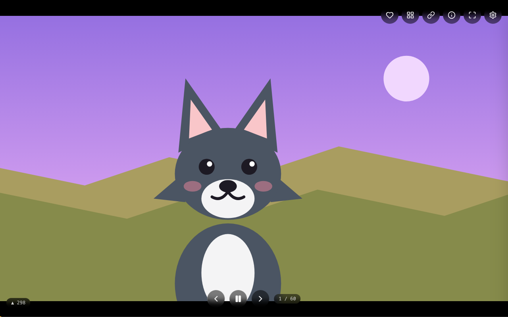
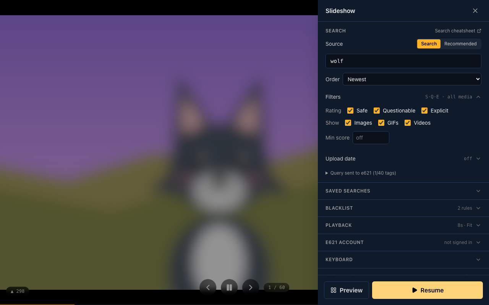
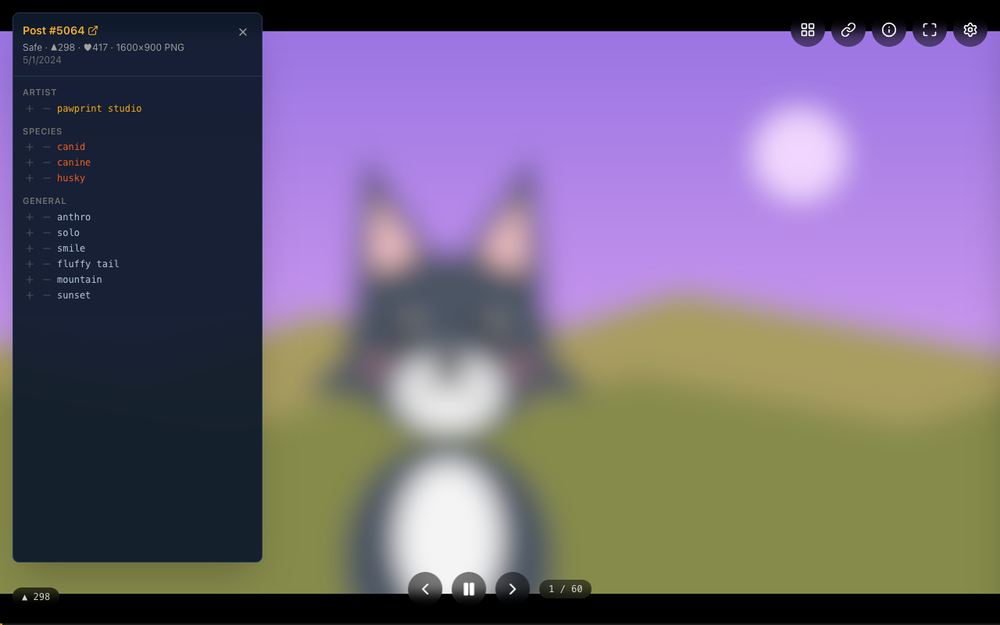
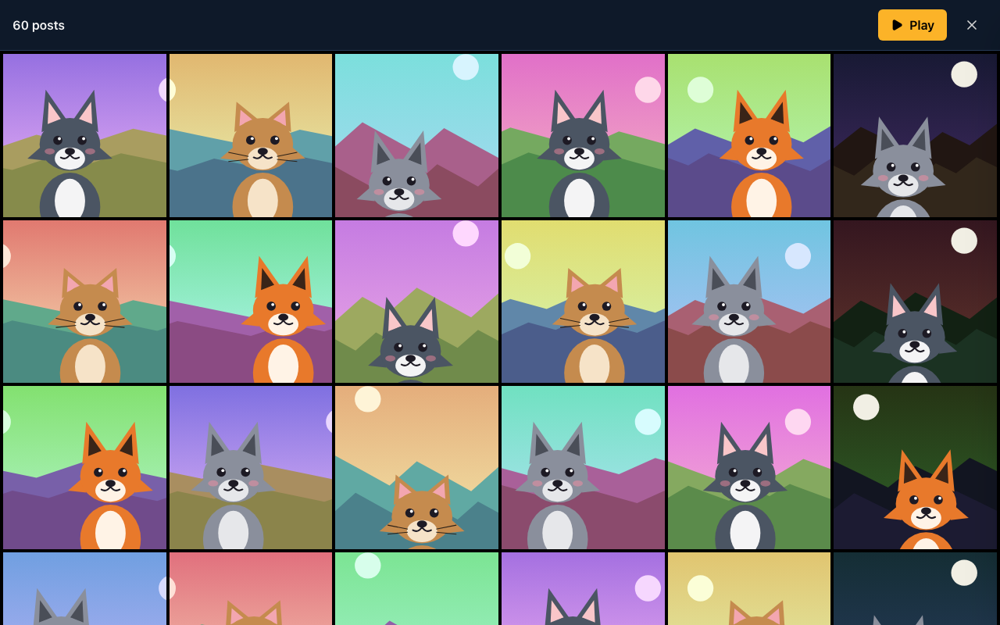
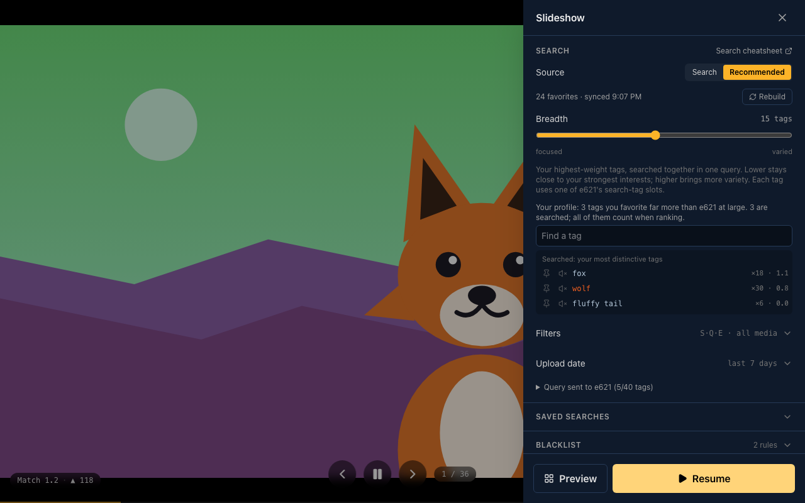

# e621 Slideshow

A full-screen slideshow for e621 searches, with four extra display styles, a grid gallery, share links,
and a **Recommended** mode that learns your taste from your favorites.

Live at **<https://e621.cumdump.dog>**. Everything runs in your browser and talks to `e621.net` directly
(the API allows CORS), so your API key never touches a server.



> Screenshots use generated, blurred placeholder characters against a mocked e621, never real posts.
> See [Regenerating the screenshots](#regenerating-the-screenshots).

## Quick start

```bash
pnpm install
pnpm dev            # http://localhost:3000
```

1. The settings panel opens on load. Type tags into **Search tags** (autocomplete helps).
2. Pick ratings and media types under **Filters**.
3. Hit **Play**.

Move the mouse to show the controls; they hide after 2.5 s idle.

## Contents

- [Features](#features)
- [Usage examples](#usage-examples)
- [Keyboard shortcuts](#keyboard-shortcuts)
- [Share links and launch links](#share-links-and-launch-links)
- [Userscript](#userscript)
- [How it works](#how-it-works)
- [Development](#development)

## Features

### Search and filter



- **Search tags** with e621 autocomplete. Any e621 syntax works: `-tag`, `~a ~b`, `score:>50`, `pool:123`.
  The **Search cheatsheet** link opens e621's own syntax guide.
- **Order**: Newest, Oldest, Score, Favorites, Random (with **Reshuffle**), Hot, Most comments, Largest.
- **Filters**: ratings (Safe / Questionable / Explicit), media (Images / GIFs / Videos), and **Min score**
  (skipped if your tags already have a `score:` term).
- **Upload date**: **Quick** (today, yesterday, past week / month / year), **Last…** N days / weeks /
  months / years, or **On**, **After**, **Before**, **Between** dates.
- **Query sent to e621** shows the exact tag string and how many of e621's 40 tag slots it uses.
  It warns before you go over.
- **Saved searches** keep a named search; **Recent** lists the last ones you played.
- **Preview** opens the results as a grid instead of starting the show.

Reopening settings pauses the show and keeps your place. Only changing the search restarts it;
playback settings apply live.

### Blacklist

One rule per line, same syntax as e621's: `tag1 tag2` hides posts with both, `-tag` exempts,
`~a ~b` means either, `#` starts a comment.

- Filtering happens in your browser, so rules cost no tag slots, and wildcards and `fav:me` work.
- Signed out: **Import e621 defaults** adds e621's default blacklist.
- Signed in: your account blacklist syncs on sign-in. Lines you add here stay local.

### Slideshow styles

Pick one under **Playback → Style**.

| Vintage Prints | Ken Burns |
|---|---|
|  |  |
| The current post as a colour print on a heap of grey prints, drifting slowly. | Full-bleed slow pan and zoom. Videos stay still. |
| **Collage** | **Reflections** |
|  |  |
| The last three posts as tiles, re-flowing into whichever layout shows the most image. | The post on a black floor with its mirror image; slides enter from the right. |

**Classic** (the default) is a plain full-screen slide with **Fit** (fit / fill / 1:1) and **Transition**
(fade / none) options.

Other playback settings:

| Setting | Default | What it does |
|---|---|---|
| Seconds per slide | 6 | 1 to 300 |
| Preload next | 4 | How many upcoming posts to fetch ahead |
| Quality | Original | **Fast** uses e621's smaller samples |
| Max video length | 60 s | Cut long videos short; `0` plays them to the end |
| Mute videos | on | |
| Start over after the last post | on | Loop the search |

### Post info and gallery

| Post info (**I**) | Gallery (**G**) |
|---|---|
|  |  |
| Tags by category, score, favorites, size, date. **+** adds a tag to your search, **−** excludes it. | Every loaded post as a grid. Click one to play from there; more load as you scroll. |

### Recommended



Switch **Source** to **Recommended** (needs sign-in). The app reads your favorites, finds the tags you
favorite far more often than e621 does overall, and ranks recent posts by how well they match and how
well liked they are for their age. Posts you've already favorited are left out.

- The match comes from a small model fit in your browser: your favorites against a random sample of
  e621. It learns which tags you seek out and which you avoid. Each favorite's tags are kept in this
  browser, and the random sample (10 pages) is taken once a month.

- Candidates come from two searches in the window: your top tags, plus its most popular posts (3 pages),
  so a well-liked post with only some of your tags still gets ranked.
- **Breadth** sets how many of your top tags are searched together: lower stays close to your strongest
  interests, higher brings more variety.
- **Pin** a profile tag to always search it. **Mute** a tag to hide posts carrying it.
- The window defaults to the last 7 days; change it under **Upload date**.
- **Rebuild** re-reads every favorite. Otherwise only new favorites are read.
- In the info overlay, "Recommended because" lists the tags that ranked the post, and **+ / −** pin and
  mute instead of editing a search.
- Nothing plays until every candidate page is ranked, so the best post shows first.

### e621 account

Sign in under **e621 account** with your username and an API key
(e621 → Account → **Manage API Access**). Signing in:

- shows posts e621 hides from anonymous users,
- lets you favorite with the heart (**L**),
- syncs your account blacklist,
- unlocks Recommended.

Tick **Remember on this device** to keep the key in this browser's `localStorage`; otherwise it lasts until
you reload or close the tab. It is only ever sent to e621.

## Usage examples

**Play one artist's best work, largest first, no videos:**

1. Search tags: `artist_name score:>100`
2. Order: **Largest**
3. Filters: untick **Videos**, then **Play**

**Shuffle a pool:**

1. Search tags: `pool:12345`
2. Order: **Random (shuffle)**. Hit **Reshuffle** for a new order.

**This week's hot posts, SFW only:**

1. Order: **Hot**
2. Filters: untick **Questionable** and **Explicit**
3. Upload date: **Quick** → **Past week**

**Hide a tag everywhere, except on one artist:**

```text
# blacklist
feral -artist_name
```

**Send a friend your current show:** press **C** (or the link button) and paste the link.
It opens straight into the show. Their own blacklist still applies.

**Start a show from a bookmark:**

```text
https://e621.cumdump.dog/?tags=fox+solo+score:>100
```

It plays the same posts e621 would show for that search, in your own style and speed.

## Keyboard shortcuts

| Key | Action |
|---|---|
| ← → | Previous / next |
| Space | Pause / play |
| F | Fullscreen |
| I | Post info (add / exclude tags) |
| L | Favorite (signed in) |
| G | Gallery |
| O | Open the post on e621 |
| C | Copy share link (not in Recommended) |
| S / Esc | Settings |

In the gallery, **G** or **Esc** closes it and arrows scroll the grid.

## Share links and launch links

There are two kinds of link.

**Share links** (**C** or the link button) carry the search *and* how it plays. They start the show
straight away and save nothing until the visitor changes a setting. Only values that differ from the
defaults are included:

| Param | Meaning | Example |
|---|---|---|
| `v` | Link format version | `1` |
| `tags` | Search tags | `fox+solo` |
| `r` | Ratings | `sq` (safe + questionable) |
| `m` | Media: **i**mage, **g**if, **v**ideo | `ig` |
| `order`, `seed` | Order, and the shuffle seed for `random` | `random`, `48213` |
| `min` | Min score | `50` |
| `d`, `dp`, `d1`, `d2`, `dn`, `du` | Upload-date filter | `d=preset&dp=week` |
| `style`, `int`, `fit`, `tr`, `q` | Style, seconds, fit, transition, quality | `style=kenburns&int=10` |
| `mute`, `vmax`, `loop` | Video mute, max length, loop | `mute=0` |

The blacklist and everything Recommended-specific are never shared.

**Include my sign-in in share links** (e621 account section) adds your username and API key to the
link's `#` fragment. Browsers never send the fragment to a server; the visitor is signed in for that tab
only and nothing is saved. Only share these with people you trust with your key.

**Launch links** (`/?tags=wolf+solo`) play an e621 search straight away, exactly as e621 runs it:
default filters (all ratings and media, newest first), so you see the same posts. Your own blacklist
and playback settings (style, speed…) still apply, and nothing is saved. The [userscript](#userscript)
uses these.

## Userscript

Adds a **▶ Slideshow** button under the search box on e621.net and e926.net. It plays what's in
the search box (or the pool you're on): the same posts e621 shows, in your saved slideshow style
and speed.

### Install

1. Add a userscript manager to your browser:
   - Chrome, Edge, Brave, Firefox: [Violentmonkey](https://violentmonkey.github.io/) or
     [Tampermonkey](https://www.tampermonkey.net/)
   - Safari (Mac, iPhone, iPad): the free **Userscripts** app from the App Store, then turn it on in
     Safari → Settings → Extensions
2. **Chrome, Edge, Brave only:** let the manager run scripts. Open `chrome://extensions`, click
   **Details** on Violentmonkey/Tampermonkey, and turn on **Allow User Scripts**. (Older versions
   have no such toggle: turn on **Developer mode** at the top right of the Extensions page instead.)
   Without this the script installs but never runs.
3. Open <https://e621.cumdump.dog/e621-slideshow.user.js>. The manager shows an install page.
4. Click **Install**, then reload any e621 page.

The manager checks that same URL for updates. The same steps, with an **Install userscript** button,
are in the slideshow's own settings under **e621 button**.

**No button?** Click the manager's toolbar icon on an e621 page. The script should be listed and
switched on. If the list is empty, recheck step 2 and that the manager is allowed on e621.net.

### Developing it

Source: [`public/e621-slideshow.user.js`](public/e621-slideshow.user.js), served from the site root.
Bump `@version` whenever you change it, or installed copies won't update. The button opens
[launch links](#share-links-and-launch-links) (`/?tags=…`).

## How it works

- **Stack**: Next.js 16 (App Router), React 19, Tailwind CSS 4, deployed on Vercel. The page is a
  single client component; there is no backend.
- **Query** ([`src/lib/query/build.ts`](src/lib/query/build.ts)): your tags, then rating / type / date /
  score / order metatags, up to e621's 40-tag limit. The blacklist never goes into the query.
- **Blacklist** ([`src/lib/query/blacklist.ts`](src/lib/query/blacklist.ts)): e621's rule semantics,
  run on each post client-side.
- **Queue** ([`src/lib/slideshow/queue.ts`](src/lib/slideshow/queue.ts)): pages through results with
  e621's cursor paging and preloads the next posts.
- **Recommended** ([`src/lib/recommend/`](src/lib/recommend)):
  - `sync.ts` reads favorites incrementally and looks up each tag's site-wide count.
  - `weights.ts` scores each tag by how much more common it is in your favorites than on e621
    (capped, damped for small counts, meta tags ignored).
  - `rank.ts` scores a post by its 5 strongest matching tags, so common tags can't swamp a rare favorite,
    then orders posts by taste percentile + quality percentile (favorites compared with posts uploaded
    around the same time).
  - `learn.ts` and `model.ts` fit logistic-regression tag weights (favorites against random posts) at
    sync; when present they replace the match score in the ranking. The lift weights still pick the
    search tags, decide which posts match, and explain them.
  - `stream.ts` fetches the tag search and 3 pages of the window's popular posts, drops your favorites,
    then plays the rest best first.
  - [`scripts/rec-backtest.ts`](scripts/rec-backtest.ts) tests search and ranking changes on live data: it
    hides accounts' recent favorites and counts how many the recommendations would show.
- **Storage** ([`src/lib/storage.ts`](src/lib/storage.ts)): settings, saved searches, history,
  credentials and the taste profile live in `localStorage`. Each favorite's tags, the random sample and
  the learned weights are bigger, so they go to IndexedDB ([`src/lib/bigStorage.ts`](src/lib/bigStorage.ts)).

### Project layout

| Path | What's there |
|---|---|
| `src/components/App.tsx` | Show state, keyboard, controls, share / launch handling |
| `src/components/SettingsPanel.tsx` | The settings drawer |
| `src/components/stages/` | One component per slideshow style |
| `src/components/Gallery.tsx`, `InfoOverlay.tsx` | Grid view and post info |
| `src/lib/e621/` | API client and response types |
| `src/lib/query/`, `src/lib/recommend/`, `src/lib/slideshow/` | Query building, recommendations, queue and layouts |
| `src/lib/share.ts` | Share-link and launch-link encoding |
| `e2e/` | Playwright tests against a mocked e621 |
| `scripts/` | Live smoke test, test-video generator, README screenshots |

## Development

```bash
pnpm dev                    # dev server on :3000
pnpm test                   # unit tests (vitest)
pnpm e2e                    # Playwright against a mocked e621, never the real API
pnpm lint && pnpm typecheck && pnpm build
```

Optional read-only smoke test against the real e621 (start `pnpm dev --port 3621` first):

```bash
node scripts/live-smoke.mjs <dir>
```

`e2e/fixtures/clip.webm` is regenerated by `node scripts/make-test-video.mjs`.
Headless Chromium can't decode e621's VP9 videos, so video playback in the live smoke only checks
metadata and timing. Check real video playback in a normal browser.

### Regenerating the screenshots

```bash
pnpm screenshots
```

Runs [`scripts/readme-screenshots/shots.ts`](scripts/readme-screenshots/shots.ts) against the e2e mock
with generated, blurred SVG characters and writes `docs/screenshots/*.png`. It reuses a dev server on port 3621
if one is running.
